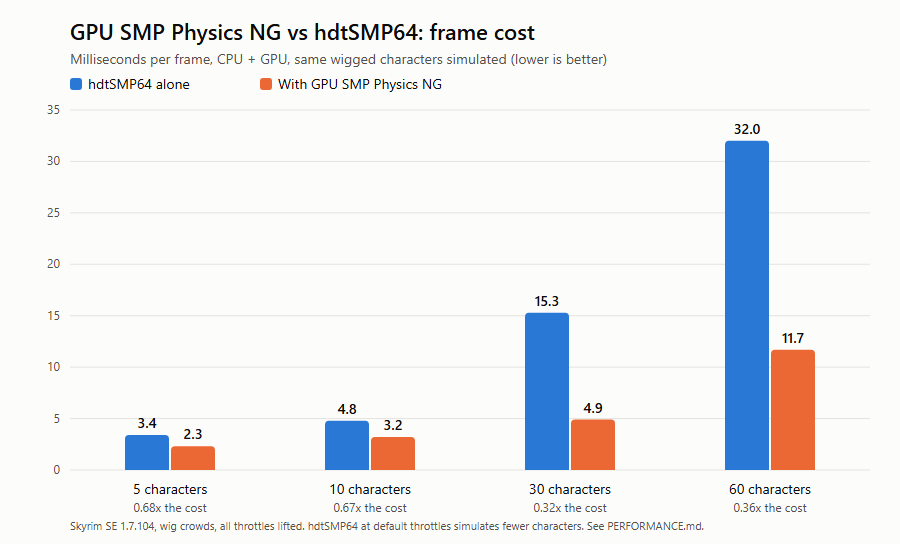

# GPUSMPPhysicsNG

GPU hair and cloth physics for Skyrim SE, AE and VR, built as a companion to
[hdtSMP64](https://github.com/alandtse/hdtSMP64). It reads the same SMP XML rigs, steps them with a
rigid-body solver on the GPU that reproduces hdtSMP64's constraints, and skins the meshes from the
solver's result. One DLL covers all three runtimes.

It claims only the meshes whose physics file describes a bone chain; hdtSMP64 keeps simulating
everything else, so the two run side by side.

## Requirements

- hdtSMP64 with plugin interface 2.2 or newer (mesh owner API and frame events), loaded before this plugin. Until the
  upstream pull requests [#479](https://github.com/DaymareOn/hdtSMP64/pull/479) and
  [#480](https://github.com/DaymareOn/hdtSMP64/pull/480) are released, use the
  [alandtse/hdtSMP64](https://github.com/alandtse/hdtSMP64) fork.
- [SKSE Menu Framework](https://github.com/alandtse/SKSE-Menu-Framework-3) for the in-game settings page (optional)
- [Community Shaders / Open Shaders](https://github.com/alandtse/open-shaders) for wind (optional); without it the weather's wind is used

## Install

Copy `SKSE/Plugins` into `Data`. The plugin compiles its HLSL on your machine from
`Data/SKSE/Plugins/GPUSMPPhysicsNG/Shaders` the first time a mesh is claimed, unless the shipped
`ShaderCache` already holds it.

Settings live in `Data/SKSE/Plugins/GPUSMPPhysicsNG/Settings.json`, written with defaults on first run, and on the
"GPU SMP Physics NG" page of SKSE Menu Framework. Set `Enabled` to false to hand every mesh back to hdtSMP64.
The log is `GPUSMPPhysicsNG.log` next to the other SKSE logs; it names the hdtSMP64 interface version it linked to
and how many meshes it claimed.

## Sharing meshes with other plugins

Plugins that register with hdtSMP64's owner API are asked for each mesh in priority order, and the first to claim it
simulates it. This plugin registers at priority 0. Open Shaders ships the same feature; run only one of the two
(turn off its "GPU SMP Physics" in `SmpPhysics.ini`) when you use this plugin.

## Performance

On a crowd of 30 wigged characters on SE, this plugin plus hdtSMP64's remaining work costs about a third of what
hdtSMP64 alone spends on the same characters (about 5 ms against 15 ms per frame). At its default throttles hdtSMP64
simulates fewer characters, so it can cost less in absolute terms. Method, caveats and per-pass figures are in
[docs/PERFORMANCE.md](docs/PERFORMANCE.md).



## Status

Checked in game on SE and VR. AE is built but not tested. Known differences from hdtSMP64 are in
[docs/PARITY.md](docs/PARITY.md).

## Build and test

Needs xmake and MSVC (run from PowerShell; xmake picks MinGW under Git Bash).

```
git submodule update --init --recursive
xmake f -m releasedbg --toolchain=msvc -y
xmake build GPUSMPPhysicsNG
xmake build GPUSMPPhysicsNG-Tests
xmake run GPUSMPPhysicsNG-Tests
```

`GPUSMP_DEPLOY=1` with `SkyrimPluginTargets` or `SkyrimVRPluginTargets` (a `Data` folder) copies the
DLL and shaders into a game install after a build.

## Layout

- `src/smp`: engine-free solver core (rig building, packing, collision, skinning math)
- `src/d3d`: D3D11 solver dispatch; `src/engine`, `src/Features`, `src/plugin`: game integration
- `src/ui`: SKSE Menu Framework settings page
- `shaders`: HLSL
- `tests`: Catch2 suite, including a WARP-device smoke test of the GPU solver

## License

GPL-3.0-or-later with the modding exception in `EXCEPTIONS.md`.
