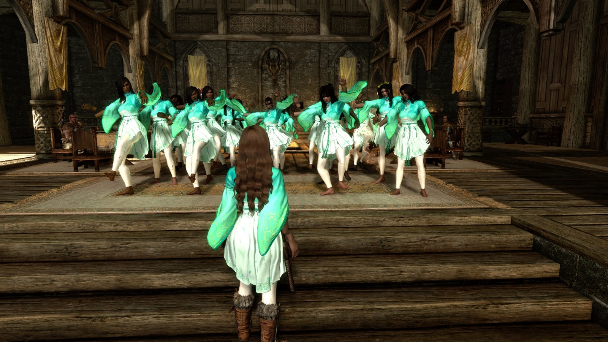
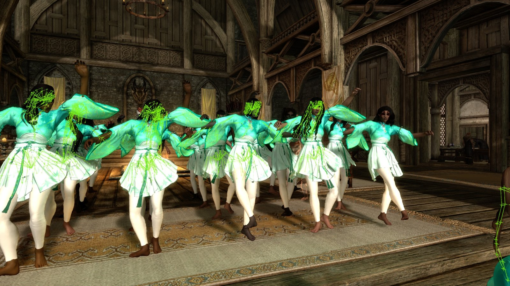
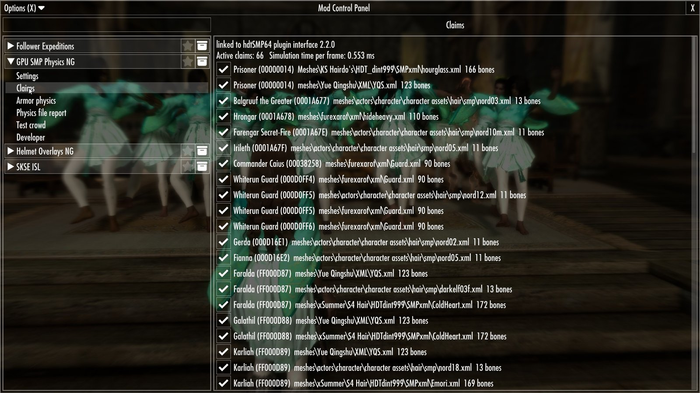

# GPUSMPPhysicsNG

GPU hair and cloth physics for Skyrim SE, AE and VR, built as a companion to
[Faster SMP (hdtSMP64)](https://www.nexusmods.com/skyrimspecialedition/mods/57339). It reads the same SMP XML rigs, steps them with a
rigid-body solver on the GPU that reproduces hdtSMP64's constraints, and skins the meshes from the
solver's result. One DLL for **SE, AE, and VR**.

**Download:** [Nexus Mods](https://www.nexusmods.com/games/skyrimspecialedition/mods/199175) ·
**Source:** [github.com/alandtse/GPUSMPPhysicsNG](https://github.com/alandtse/GPUSMPPhysicsNG) (GPL-3.0 with modding exception)

It claims only the meshes whose physics file describes a bone chain; hdtSMP64 keeps simulating
everything else, so the two run side by side.



## Requirements

- **SE/AE**: [SKSE64](https://skse.silverlock.org/), [Address Library](https://www.nexusmods.com/skyrimspecialedition/mods/32444)
- **VR**: SKSE VR and a [VR Address Library](https://www.nexusmods.com/skyrimspecialedition/mods/58101) that carries
  id 101335 (the plugin does not load without it)
- hdtSMP64 with plugin interface 2.2 or newer (mesh owner API and frame events), loaded before this plugin. Until the
  upstream pull requests [#479](https://github.com/DaymareOn/hdtSMP64/pull/479) and
  [#480](https://github.com/DaymareOn/hdtSMP64/pull/480) are released, use the
  [alandtse/hdtSMP64 4.1.1 preview build](https://github.com/alandtse/hdtSMP64/releases/tag/v4.1.1-ci-gpusmp-4bda2cc).
- Optional: [SKSE Menu Framework](https://www.nexusmods.com/skyrimspecialedition/mods/120352) for the in-game settings page.
  Without it, edit `Settings.json`.
- Optional: [Open Shaders](https://www.nexusmods.com/skyrimspecialedition/mods/180419) for wind; without it the
  weather's wind is used

The preview build also carries hdtSMP64's Tracy profiling and trace export
([#481](https://github.com/DaymareOn/hdtSMP64/pull/481), [#482](https://github.com/DaymareOn/hdtSMP64/pull/482),
[#483](https://github.com/DaymareOn/hdtSMP64/pull/483)); this plugin does not need them.

## Install

Copy `SKSE/Plugins` into `Data`. The plugin compiles its HLSL on your machine from
`Data/SKSE/Plugins/GPUSMPPhysicsNG/Shaders` at startup, in the background, unless the shipped
`ShaderCache` already holds it.

Settings live in `Data/SKSE/Plugins/GPUSMPPhysicsNG/Settings.json`, written with defaults on first run, and on the
"GPU SMP Physics NG" page of SKSE Menu Framework. Set `Enabled` to false to hand every mesh back to hdtSMP64.
The log is `GPUSMPPhysicsNG.log` next to the other SKSE logs; it names the hdtSMP64 interface version it linked to
and how many meshes it claimed.

## Sharing meshes with other plugins

Plugins that register with hdtSMP64's owner API are asked for each mesh in priority order, and the first to claim it
simulates it. This plugin registers at priority 0.

## Wind

Outdoors, wind pushes hair and cloth. With Open Shaders installed the plugin samples the wind field Open Shaders
publishes, so the push follows the scene; without it, the weather's wind is used. One "Wind strength" setting scales it
for hair and cloth together (default 6, 0 switches wind off), and hair is sheltered from it indoors and by the
character's own body. The scale is not hdtSMP64's, so wind will not match hdtSMP64 exactly.

## VR hands

In VR your hands touch hair. With "React to nearby bodies and hands" on (the default), hands and held weapons or objects
push the hair as they pass through it, so you can run a hand through a wig. With "Hold hair with a closed hand" on
(also the default), closing a hand on a strand holds it to the hand until the hand opens, and pulling moves the rest of
the hair with it. If HIGGS is installed the plugin tells a grip on hair apart from picking up an object, and keeps
HIGGS from grabbing with a hand that is holding hair. Both settings are on the Settings page; the grab overlay is on the
Developer page. These were tested in VR with scripted controllers, not a headset; reports from real controllers are
welcome.

## Tools for mod authors

With SKSE Menu Framework installed, the "GPU SMP Physics NG" menu has pages for finding and fixing physics problems
without spawning a single NPC by hand:

- **Physics file report**: the faults found in physics files this session and what was done about them, as text for each
  file's author, plus physics files no model uses and files a model names that do not exist (loose files only).
- **Claims**: every mesh the plugin simulates, per actor and file with its bone count, each switchable on and off, and
  the meshes it declined with the reason.
- **Test bench** (Developer mode): scans every armor, cloak and head part for physics data and checks each physics file.
  The lists are coloured: green works, amber was repaired and used, red has a file fault, plain has no physics. Pick an
  item to see its report and copy it to paste to the author. It also spawns wigged characters in rows ahead of you, so
  "Apply to" can dress them, the target or nobody (browse only) with armor, cloaks, wig colours and idle animations.
  Useful for checking a wig, a cloak or a whole armor list against the solver.
- **Developer**: debug overlays for colliders, skeletons and joints (joints are coloured by who simulates them: GPU,
  claimed but not stepped, inactive, or hdtSMP64 on the CPU; stretched joints are marked), and a shader reload.





## Performance

On a crowd of 30 wigged characters on SE, this plugin plus hdtSMP64's remaining work costs about a third of what
hdtSMP64 alone spends on the same characters (about 5 ms against 15 ms per frame), and about a third at 60 (11.7 ms against 32.0 ms). At its default throttles hdtSMP64
simulates fewer characters, so it can cost less in absolute terms. Method, caveats and per-pass figures are in
[docs/PERFORMANCE.md](docs/PERFORMANCE.md).


## Status

Checked in game on SE and VR. AE is built but not tested. Known differences from hdtSMP64 are in
[docs/PARITY.md](docs/PARITY.md).

## Build and test

Needs xmake and MSVC (run from PowerShell; xmake picks MinGW under Git Bash).

```
git submodule update --init --recursive
xmake f -a x64 -m releasedbg --toolchain=msvc --tests=y -y
xmake build GPUSMPPhysicsNG
xmake build GPUSMPPhysicsNG-Tests
xmake run GPUSMPPhysicsNG-Tests
```

`GPUSMP_DEPLOY=1` with `SkyrimPluginTargets` or `SkyrimVRPluginTargets` (a `Data` folder) copies the
DLL and shaders into a game install after a build.

## Layout

- `src/smp`: engine-free solver core (rig building, packing, collision, skinning math)
- `src/d3d`: D3D11 solver dispatch; `src/engine`, `src/Features`, `src/plugin`: game integration
- `src/ui`: SKSE Menu Framework settings page
- `shaders`: HLSL
- `tests`: Catch2 suite, including a WARP-device smoke test of the GPU solver

## Credits

- [hdtSMP64](https://github.com/DaymareOn/hdtSMP64): the SMP XML rigs, constraint behaviour and plugin interface this
  plugin reproduces and builds on.
- [Bullet Physics](https://github.com/bulletphysics/bullet3): the model for the rigid-body solver.
- [CommonLibVR](https://github.com/alandtse/CommonLibVR/tree/ng), the CommonLibSSE-NG fork this builds against.
- [Yue Qingshu Dress](https://www.nexusmods.com/skyrimspecialedition/mods/48379): the outfit in the screenshots.

## License

GPL-3.0-or-later WITH LicenseRef-Modding-Exception. See [COPYING](COPYING) and [EXCEPTIONS.md](EXCEPTIONS.md).
