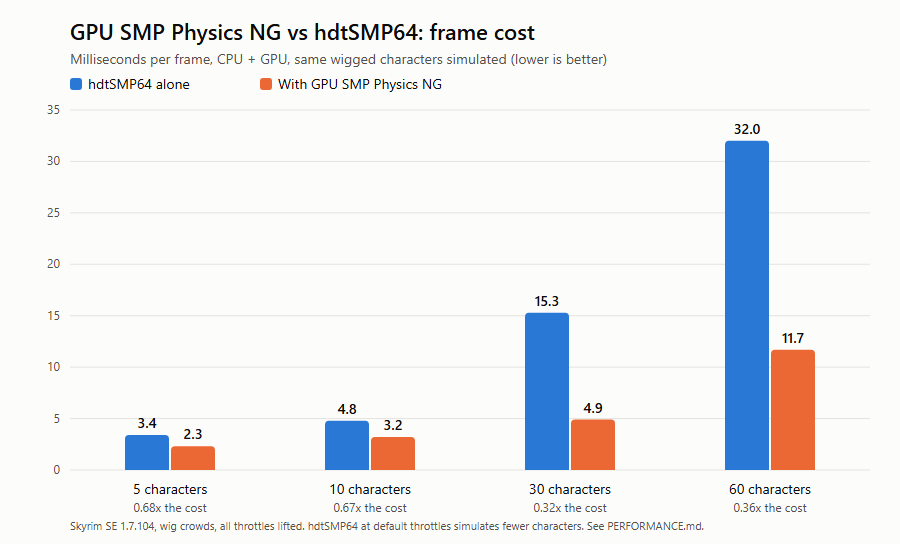

# Performance against hdtSMP64

Measured on Skyrim SE 1.7.104 with the test crowd (wigged characters, 10 bases repeated) in one scene. Both plugins were
built with Tracy; zone totals come from `tracy-capture` and `tracy-csvexport`, 20 s per arm. Harnesses are in
[perf-data](perf-data).

## Method

- Every throttle is lifted so both arms simulate the same characters: hdtSMP64 `configs.json` (`autoAdjustMaxSkeletons`
  false, `maximumActiveSkeletons` 1000, `budgetMs` 1000, `minCullingDistance` 100000, `minScreenSizePercent` 0) and here
  `MaxClaims` and `MaxSimulatedClaims` 256, `SimulationDistance` 20000, `MinScreenSizePercent` 0.
- hdtSMP64's `PhysicsStep` with the plugin disabled is compared with the plugin's CPU `Step`, its GPU `RigidContact` and
  `RigidSolve`, and hdtSMP64's `PhysicsStep` on what the plugin does not claim. GPU time is asynchronous, so the sum is a
  conservative total.

## Result, wigs, per frame

| Crowd | hdtSMP64 | Plugin cpu + gpu + residual | Ratio |
| ----- | -------- | --------------------------- | ----- |
| 5     | 3.4 ms   | 0.76 + 1.42 + 0.14 = 2.3 ms | 0.68  |
| 10    | 4.8 ms   | 1.16 + 1.79 + 0.25 = 3.2 ms | 0.67  |
| 30    | 15.3 ms  | 4.9 ms                      | 0.32  |
| 60    | 32.0 ms  | 3.34 + 5.73 + 2.58 = 11.7   | 0.36  |

At 30 characters hdtSMP64 ranged 15.3 to 20.5 ms over three runs, so its cost is noisier than the plugin's. The Yue
Qingshu Dress crowd of 30 costs hdtSMP64 36.6 ms against the plugin's 10.8 ms (about 0.29), from separate launches.

At default throttles (30 characters, hdtSMP64 simulating about 5 skeletons) hdtSMP64 costs 2.9 ms and the plugin 4.1 ms,
because the plugin simulates all 72 claims. The advantage is per character, not at defaults.

## Where the plugin's time goes

Per call on SE, 10/20/30 characters: `ContactSpheres` 0.64/1.18/1.13 ms and `RigidSolve` 0.74/0.77/0.82 ms. On VR
(null driver) the same passes cost 0.33 to 0.75 ms and about 0.58 ms, so about 2.5 ms of an 11.1 ms frame at 20
characters. Contact is the largest pass.

## Cost of the skirt contact fix

On SE, Tracy, 126 claims (30 characters in DD Elanor Timeless Elegance), every throttle lifted, one run per arm. Posing the
collision surface on the bodies' clock and giving each contact its driver's velocity added 0.87 ms of main thread
(`Step` 3.82 to 4.69 ms, all of it the per-substep contact callback) and 0.34 ms of GPU (`SurfacePrep` now runs per
substep, 0.17 to 0.36 ms; `ContactSpheres` per call is unchanged). Bounding the callback's driver loop to the packed
claims and building the delta once per step takes `Step` to 3.76 ms and the callback from 1.67 to 0.24 ms. Frame
generation and the engine frame lock were not changed, so frame time is not reported.

## Things that did not help

- Routing small islands to the sequential `RigidSolveIsland` kernel made `RigidSolve` slower (0.62 ms coloured-only
  against 1.5 to 2.8 ms).
- Tighter deep-push leaf bounds could save at most about 0.35 ms per frame at 20 characters and cost a new record format.
- Prepacking the coloured solve's body table: its build already costs nothing measurable.
- `FlushAfterSubmit` removes a misattributed 8 to 9 ms wait from the per-pass timers on SE (the commands sit in the
  driver until the game flushes) but gave no frame-time gain, so it ships off. Turn it on only when reading GPU pass times.

## Contacts posed at the end of the substep

Posing the body surfaces at the end of each substep instead of the start (`SmpStepClock::EndFraction`) adds no pass or
dispatch. SE, Tara dress, 500-frame sprint, frame time with the recorder running: 10.2 to 10.4 ms mean (p99 13.2 to 13.5)
before, 10.0 to 10.3 ms (p99 12.2 to 12.5) after. Deep contacts (>4 units) at the drawn pose fell from 39-40 to 11-20 per
500 frames. `gpuPassStats` was not read for this change.

## Not measured

VR frame time (the null driver caps the frame near 31 ms), capes, AE, frame generation state.
